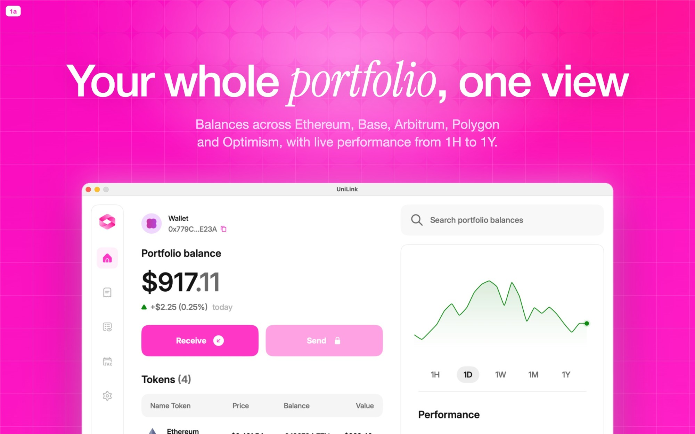
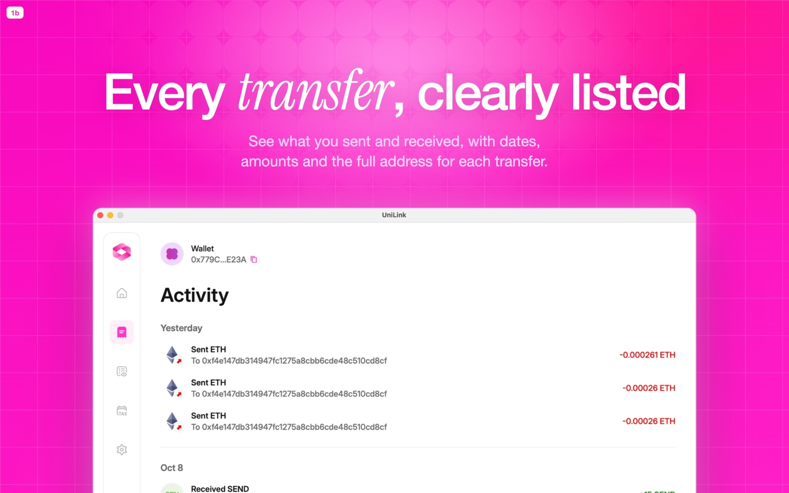
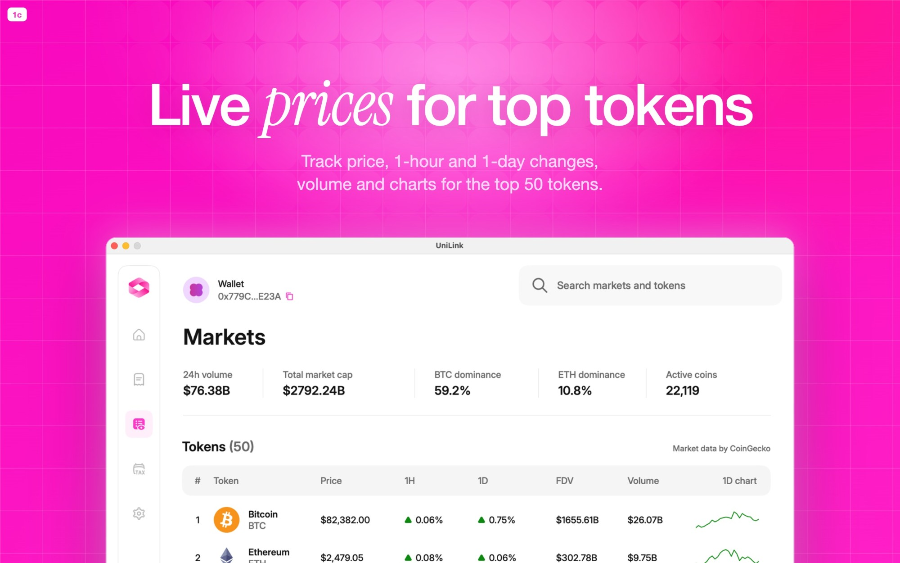
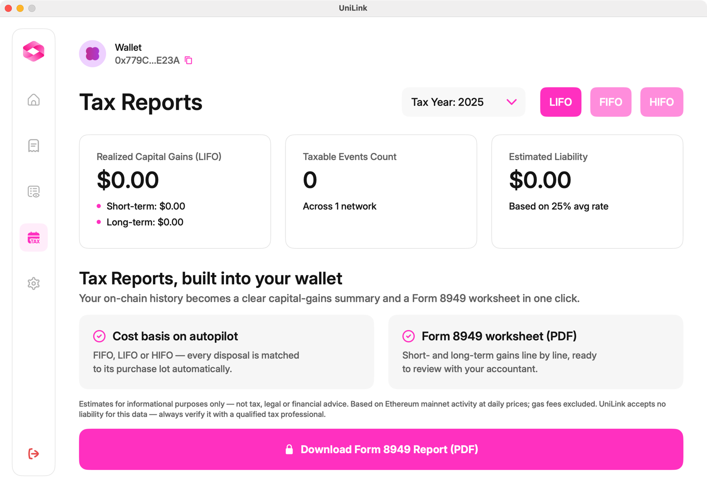
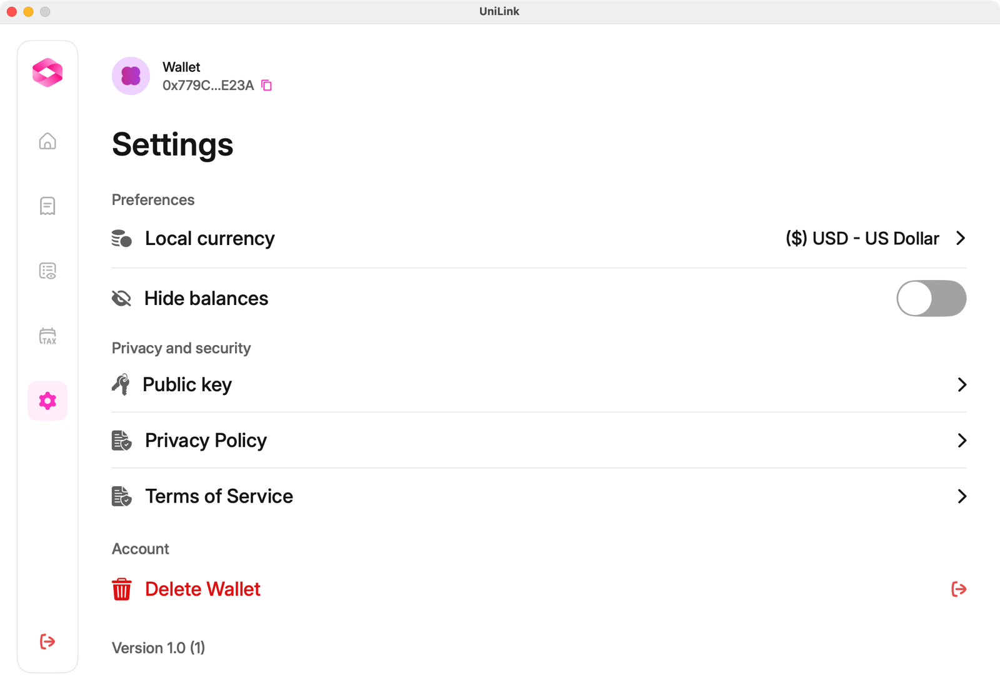

<p align="center">
  
</p>

<h1 align="center">UniLink</h1>

<p align="center">
  <b>The self-custody crypto wallet, built for Mac.</b><br>
  Send, receive and track your tokens on Ethereum, Base, Arbitrum, Polygon and Optimism.<br>
  Your keys never leave your Mac.
</p>

<p align="center">
  <a href="https://apps.apple.com/app/id6821127755"><b>↓ Download on the Mac App Store</b></a>
  &nbsp;·&nbsp;
  <a href="https://unilink.tools">Website</a>
</p>

<p align="center">
  Free · macOS 14 Sonoma or later · Apple Silicon &amp; Intel
</p>

---

## Your whole portfolio, one view

Balances across Ethereum, Base, Arbitrum, Polygon and Optimism, with live performance from 1H to 1Y.

<p align="center"></p>

## Every transfer, clearly listed

See what you sent and received, with dates, amounts and the full address for each transfer.

<p align="center"></p>

## Live prices for top tokens

Track price, 1-hour and 1-day changes, volume and charts for the top 50 tokens. Market data by CoinGecko.

<p align="center"></p>

## Features

| | |
|---|---|
| **Self-custody** | Your recovery phrase is generated on-device and kept only in the macOS Keychain. Never uploaded, never synced to iCloud. |
| **Send & receive** | ETH, POL and ERC-20 on five networks. See the full address, network and maximum fee before you confirm. Transactions are signed locally. |
| **Portfolio** | Every chain in one balance, a watch-only mode for any address, and live market prices. |
| **Tax reports** | FIFO, LIFO or HIFO estimates and a Form 8949-style PDF worksheet to review with your accountant. |
| **Private by default** | No account, no email, no tracking. Only public blockchain data ever leaves your Mac. |
| **Address avatars** | A unique picture per address to help spot look-alike scams. |

<p align="center">
  
  
</p>

## How it's built

UniLink is a native macOS app written in **Swift** and **SwiftUI** (macOS 14+), with no web views and no third-party UI frameworks.

| Area | Implementation |
|---|---|
| UI | SwiftUI, with AppKit for window and cursor details. Custom theme, charts and sparklines drawn natively. |
| Wallet | BIP-39 recovery phrases, BIP-32/44 key derivation and Keccak-256 addresses, implemented in Swift under `Services/Crypto`. |
| Signing | EIP-1559 (type 2) Ethereum transactions signed on-device with [swift-secp256k1](https://github.com/21-DOT-DEV/swift-secp256k1) (libsecp256k1). |
| Key storage | The recovery phrase lives only in the macOS Keychain (`WhenUnlockedThisDeviceOnly`, not synchronizable). |
| Data | Public balances and history from [Alchemy](https://www.alchemy.com), market data from [CoinGecko](https://www.coingecko.com). Only public wallet addresses are ever sent. |
| Tax reports | FIFO / LIFO / HIFO cost-basis engine and a Form 8949-style PDF generated with Core Graphics and Core Text. |
| Distribution | Signed, sandboxed build delivered through the Mac App Store. |

### Project layout

```
UniLink/
├── App/          App state and navigation
├── Design/       Theme, interaction and cursor helpers
├── Components/   Sidebar, token rows, charts, address avatars, modals
├── Screens/      Onboarding, Portfolio, Activity, Markets, Tax Reports, Settings
└── Services/     Stores, wallet API, send flow, PDF export
    └── Crypto/   BIP-39, secp256k1, Keccak-256, Ethereum transactions
```

> This repository is the public home of UniLink: product page, screenshots and release notes. The app is distributed through the Mac App Store.

## Install

1. Open the [UniLink page on the Mac App Store](https://apps.apple.com/app/id6821127755).
2. Click **Get**, then **Install**.
3. Open UniLink and create a new wallet, or sign in with an existing recovery phrase.

## Security notes

- UniLink will **never** ask for your recovery phrase by email, message or website. Type it only into the app on your own Mac.
- If you lose your recovery phrase, nobody, including us, can recover it or your funds.
- Blockchain transfers are final once confirmed. Always check the full recipient address and network before you send.
- Tax reports are informational estimates, not tax advice or an official IRS form.

## Support

- Website: [unilink.tools](https://unilink.tools)
- Contact: [unilink.tools/contact](https://unilink.tools/contact)
- [Privacy Policy](https://unilink.tools/privacy) · [Terms of Service](https://unilink.tools/terms)

---

<sub>© 2026 UniLink. Screenshots show a public demo address in read-only mode.</sub>
